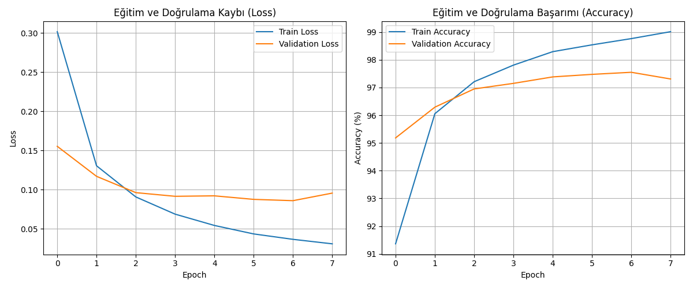
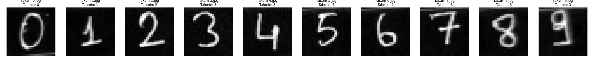

## 📊 Deney Sonuçları ve Metrikler

Eğitilen Multi-Layer Perceptron (MLP) modelinin 8 epoch boyunca gösterdiği başarım ve süre değerleri aşağıda özetlenmiştir:

| Metrik | Değer |
| :--- | :--- |
| **Training Loss (Final)** | 0.0310 |
| **Validation Loss (Final)** | 0.0961 |
| **Training Accuracy (Final)** | %99.02 |
| **Validation Accuracy (Final)** | %97.31 |
| **Test Accuracy** | **%97.40** |
| **Eğitim Süresi** | ~18.5 saniye |

---

### 📉 Eğitim ve Doğrulama Grafikleri

* **Loss (Kayıp) Analizi:** Sol taraftaki grafikte görüldüğü üzere *Training Loss* 8 epoch boyunca istikrarlı bir şekilde düşerek `0.0310` seviyesine inmiştir. *Validation Loss* ise 6. epoch civarında en düşük seviyesine (`0.0860`) ulaştıktan sonra hafif bir artış eğilimine geçmiştir.
* **Accuracy (Başarım) Analizi:** Sağ taraftaki grafikte *Training Accuracy* %99'un üzerine çıkarken, *Validation Accuracy* %97.5 civarında plato oluşturmuştur.
* **Overfitting Değerlendirmesi:** 6. epoch'tan sonra *Train Loss* düşerken *Validation Loss*'un artmaya başlaması modelin eğitim verisini ezberlemeye (overfitting) başladığını göstermektedir. Bu nedenle ideal durdurma noktası (Early Stopping) 6. epoch'tur.

---

### 🖊️ Kendi El Yazısı Verisi (Distribution Shift) Analizi

Kendi el yazımla hazırladığım rakamlar (`rakam-0.jpg` - `rakam-9.jpg`) modele girdi olarak verilmiş ve şu sonuçlar elde edilmiştir:

* **Doğru Tahmin Edilenler:** `0, 1, 2, 3, 6` (%50 Doğruluk)
* **Yanlış Tahmin Edilenler:** `4, 5, 7, 8, 9` (Hepsi **3** olarak tahmin edilmiştir)

#### 🔍 Başarısızlık ve Genelleştirme (Generalization) Nedenleri:
1. **Görüntüdeki Kenar Gürültüleri:** Kırpılan görsellerin alt ve üst sınırlarında kalan kesim çizgileri/gölgeleri, MLP modeli görüntüyü 784 piksellik tek bir vektöre dönüştürürken "3" rakamının yatay çizgileriyle çakışarak model nöronlarını yanlış yönlendirmiştir.
2. **Hizalama ve Boşluk (Padding) Farkı:** MNIST veri setindeki rakamlar $28 \times 28$ piksellik karenin tam ortasına hizalanır. Kendi hazırladığımız fotoğraflarda rakamlar çerçevenin kenarlarına çok yakın kaldığı için piksel dağılım kayması (distribution shift) oluşmuştur.
3. **MLP Mimarisinin Kısıtı:** Evrişimli ağların (CNN) aksine MLP modelleri mekânsal değişmezliğe (spatial invariance) sahip değildir. Piksellerin konumundaki ufak bir kayma veya kenar gürültüsü tahmin sonucunu doğrudan etkilemektedir.# deep-learning-odev-1
